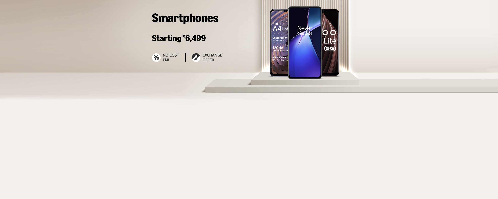
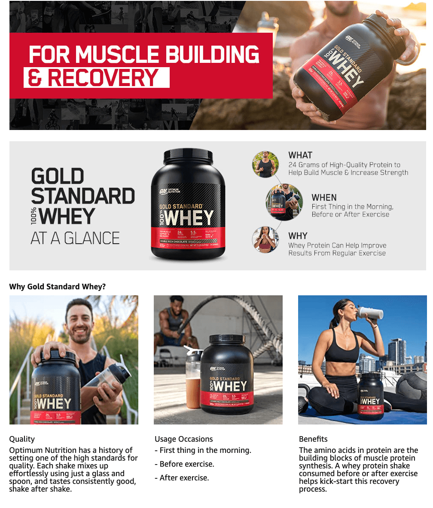
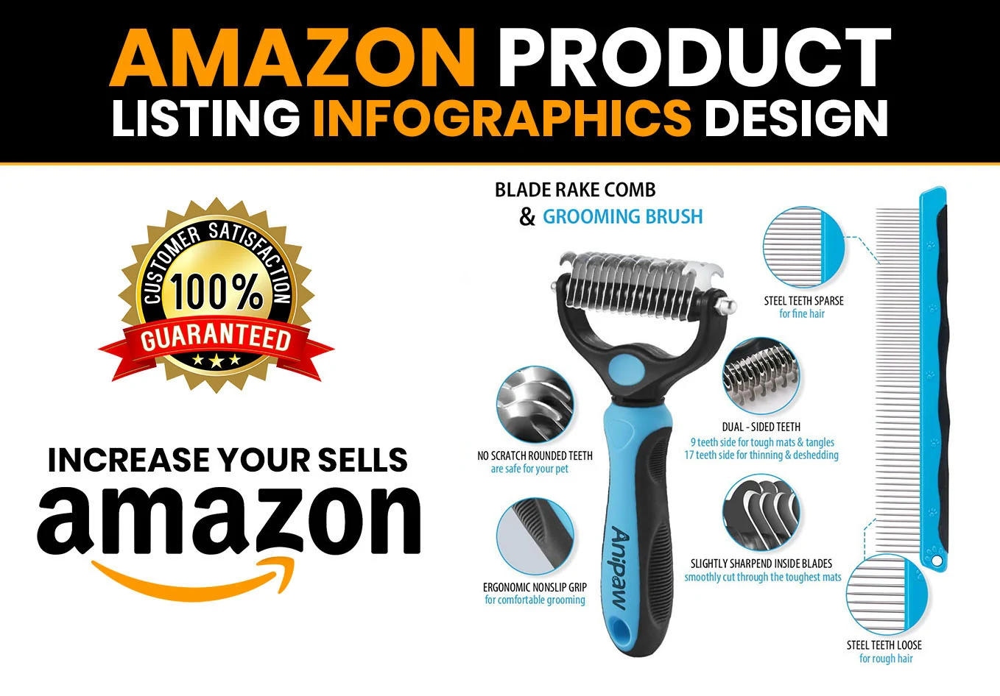
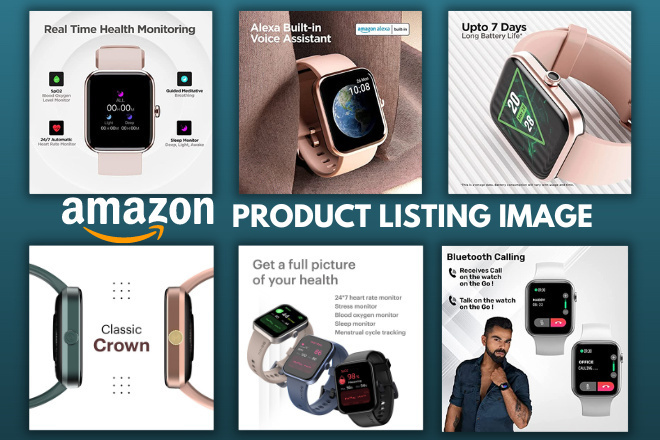
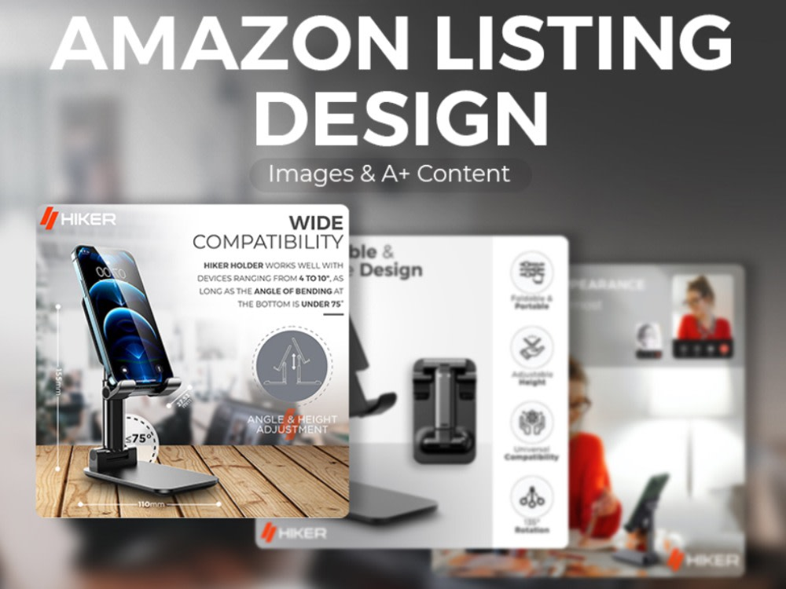
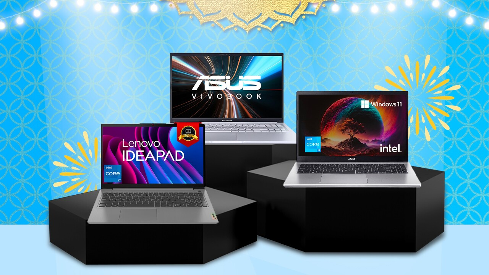

# Amazon Clone (HTML + CSS)

<p align="center">
  
</p>

A static clone of the Amazon homepage, built from scratch with **HTML5** and **CSS3**. This was my first step into web development. I wanted to practise turning a real-world design into code, focusing on page structure, layout and styling.

## Links

- **Live demo:** https://jahnu-patowary.github.io/amazon-clone/
- **Source code:** https://github.com/jahnu-patowary/amazon-clone
- **LinkedIn project post:** https://lnkd.in/p/dQyMW727
- **LinkedIn profile:** https://www.linkedin.com/in/jahnupatowary

## Screenshot


## About the Project

This project recreates the look of the Amazon homepage. It has no JavaScript or backend. Everything is done with semantic HTML for structure and CSS (mainly Flexbox) for layout and design. Building it taught me how a full web page is broken down into reusable blocks: a header, a hero section, a grid of product cards and a footer.

## Page Sections Explained

### 1. Navbar
A black top bar built with Flexbox. It contains the logo, the delivery location ("Deliver to India"), a search bar with a category dropdown and a search icon, the account and returns links, and the cart. Each item has a transparent border that turns white on hover, which gives the same hover effect as the original site.

### 2. Secondary Panel
A thin dark strip below the navbar with an "ALL" menu button, quick links (Today's Deals, Customer Service, Registry, Gift Cards, Sell) and a "Shop Deals in Electronics" highlight.

### 3. Hero Section
A large banner image set as a CSS background. A white message box sits at the bottom of the banner and links to Amazon India.

### 4. Shop Section
A responsive grid of product cards made with `display: flex` and `flex-wrap: wrap`. Each card has a title, a product image and a "SEE MORE" link.

### 5. Footer
The footer has four parts: a "Back To Top" bar, link columns (Get To Know Us), the logo strip, and a bottom bar with legal links and the copyright line.

## Product Categories

<table>
  <tr>
    <td align="center"><br>Whey Proteins</td>
    <td align="center"><br>Man Accessories</td>
    <td align="center"><br>Watches</td>
    <td align="center"><br>Untold Stories</td>
  </tr>
  <tr>
    <td align="center"><br>Mobile Phones</td>
    <td align="center"><br>Laptops</td>
    <td align="center"><br>Washing Machines</td>
    <td align="center"><br>Health Care</td>
  </tr>
</table>

## Built With

- **HTML5**: page structure and semantic tags (`header`, `footer`)
- **CSS3**: Flexbox layout, hover effects, background images, colours and spacing
- **Font Awesome**: icons for location, search, cart and menu

## Project Structure

```
amazon-clone/
├── index.html      # page structure
├── style.css       # all styling
├── amazon logo 2.webp
├── h2.jpg          # hero banner
└── box*.jpg/.webp/.png   # product images
```

## What I Learned

- Building page layouts with Flexbox (`display`, `justify-content`, `align-items`, `flex-wrap`)
- Using CSS classes to reuse styles across many elements
- Hover effects with the `:hover` selector
- Setting images as CSS backgrounds with `background-image` and `background-size: cover`
- Organising HTML and CSS so a large page stays readable

## How to Run Locally

1. Clone the repository:
   ```
   git clone https://github.com/jahnu-patowary/amazon-clone.git
   ```
2. Open the folder and double-click `index.html`, or use the **Live Server** extension in VS Code.

## Future Improvements

- Make the layout fully responsive for mobile screens
- Add working search and cart using JavaScript
- Add more pages (product details, sign in)

